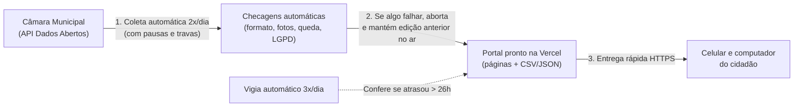

# Guia Completo do Portal — Acompanhe seu Vereador (Pindamonhangaba)

> **Para quem é este guia:** Diretoria e voluntários do **Observatório Social do Brasil – Pindamonhangaba**, cidadãos curiosos, jornalistas, advogados/DPO e futuros mantenedores (humanos ou assistentes de IA).
> **Endereço oficial no ar:** `https://acompanhe-seu-vereador.vercel.app` · **Versão:** `1.0.0` · **Atualizado em:** 18 de novembro de 2026.

---

## Sumário

1. [Glossário sem complicação (para ler sem medo de siglas)](#1-glossário-sem-complicação-para-ler-sem-medo-de-siglas)
2. [O que é o portal — e o que ele faz questão de NÃO ser](#2-o-que-é-o-portal--e-o-que-ele-faz-questão-de-não-ser)
3. [Passeio pelas telas: o que existe para o cidadão](#3-passeio-pelas-telas-o-que-existe-para-o-cidadão)
4. [Como o portal foi feito (sem economês de TI)](#4-como-o-portal-foi-feito-sem-economês-de-ti)
5. [Metodologia em profundidade: como cada número nasce](#5-metodologia-em-profundidade-como-cada-número-nasce)
6. [Como o portal se atualiza e como operar no dia a dia](#6-como-o-portal-se-atualiza-e-como-operar-no-dia-a-dia)
7. [O que o Observatório TEM que fazer e o que PODE fazer (Jurídico, Domínio, Custos e Hospedagem para ONG)](#7-o-que-o-observatório-tem-que-fazer-e-o-que-pode-fazer)
8. [Passagem de bastão: para a Diretoria e para quem assumir amanhã](#8-passagem-de-bastão-para-a-diretoria-e-para-quem-assumir-amanhã)

---

## 1. Glossário sem complicação (para ler sem medo de siglas)

Ao longo do portal e dos documentos do projeto aparecem termos técnicos da Câmara Municipal e da internet. Eles precisam continuar existindo porque dão precisão a jornalistas, advogados e auditores — mas ninguém precisa saber o significado de antemão. Aqui está a tradução direta de cada um:

| Termo ou sigla | Tradução em português direto |
|---|---|
| **API (e API de Dados Abertos)** | Vem do inglês *Application Programming Interface*. Pense nela como um **“balcão eletrônico oficial”** mantido pelo sistema da Câmara Municipal. Em vez de um voluntário entrar página por página e copiar planilhas no mouse, nosso programa bate nesse balcão eletrônico e recebe os registros públicos já estruturados e prontos para conferência automática. |
| **Token (ou `CAMARA_API_TOKEN`)** | É uma **chave numérica de identificação** gratuita que a Câmara fornece a cidadãos e entidades para consultar a API com responsabilidade. No portal, esse token fica guardado em segredo nos bastidores da hospedagem (Vercel), nunca exposto na tela do visitante. |
| **Proposição** | É qualquer texto oficial protocolado na Câmara para debate, cobrança ou criação de regra: requerimento, indicação, moção, emenda, veto ou projeto de lei. |
| **Ementa** | É o **resumo curto** que aparece logo no topo de um documento legislativo explicando do que ele trata (ex.: *“Solicita instalação de iluminação de LED no bairro Araretama”*). É o texto que o portal exibe para leitura rápida antes de você abrir o documento completo na Câmara. |
| **Norma (Lei / Resolução / Decreto)** | É o texto que **já foi aprovado e publicado** oficialmente, passando a valer como regra na cidade ou na própria Câmara. |
| **CSV e `UTF-8 com BOM`** | **CSV** é um arquivo de tabela simples feito para abrir no **Microsoft Excel**, LibreOffice ou Google Planilhas. Usamos ponto e vírgula (`;`) e o marcador **`UTF-8 com BOM`** para que acentos do português (`ç`, `ã`, `é`) apareçam perfeitos no Excel configurado em português, sem letras quebradas. |
| **JSON e Manifesto** | **JSON** é um formato de arquivo organizado para programas de computador lerem listas e campos sem ambiguidade. O **`manifesto.json`** funciona como a “ficha técnica do lote”: diz exatamente a data, a hora, a origem e quantos documentos existiam naquela coleta. |
| **`Slug`** | É o apelido padronizado usado nos endereços da internet, sem acentos nem espaços — por exemplo, o perfil de Marco Mayor vira `/vereadores/marco-mayor` e o bairro Distrito de Moreira César vira `/bairros/distrito-de-moreira-cesar`. |
| **PWA (Aplicativo Web Progressivo)** | Tecnologia do próprio navegador (Chrome, Edge, Safari) que deixa instalar o site na tela inicial do celular com ícone próprio, como um aplicativo, sem passar pela Play Store nem pela App Store. |
| **GitHub e Issue** | **GitHub** é o cofre público na internet onde o código-fonte do projeto fica guardado, transparente e auditável linha por linha. Uma **Issue** é uma ficha aberta de aviso, bug ou sugestão de melhoria vinculada ao projeto. |
| **Vercel** | Empresa onde o site mora hoje na internet (o “terreno e prédio” que montam e entregam as páginas rapidamente para qualquer navegador com cadeado HTTPS). |
| **Domínio e DNS** | **Domínio** é o endereço digitado no navegador (ex.: `acompanhe-seu-vereador.vercel.app` ou um futuro `vereadorespinda.org.br`). **DNS** é a “lista telefônica da internet” que traduz esse endereço legível para o servidor correto. |
| **VPS** | *Virtual Private Server* — na prática, alugar um pequeno computador ligado 24 horas por dia na nuvem apenas para a ONG, sem depender de limites do plano gratuito da Vercel. |
| **LGPD e LAI** | **LAI** (Lei nº 12.527/2011) é a Lei de Acesso à Informação, que garante a publicidade de dados públicos. **LGPD** (Lei nº 13.709/2018) é a Lei Geral de Proteção de Dados Pessoais, que protege dados sensíveis e a privacidade dos cidadãos mesmo quando mencionados em documentos públicos. |

---

## 2. O que é o portal — e o que ele faz questão de NÃO ser

O **Acompanhe seu Vereador** é o painel cívico aberto e gratuito do **Observatório Social do Brasil – Pindamonhangaba** (CNPJ `30.197.903/0001-75`), criado para substituir o antigo relatório manual em Power BI. Em vez de exigir que um voluntário baixe planilhas e conte itens à mão uma vez por mês, o portal consulta automaticamente os registros publicados pela Câmara Municipal duas vezes ao dia e os organiza para qualquer morador consultar pelo celular em segundos.

Em produção, o portal reúne todo o acervo da legislatura **2025–2028** (a partir de 1º de janeiro de 2025) — com mais de **17.500 proposições**, mais de **400 leis e normas** e os **11 vereadores em exercício** (com atualização contínua automática).

### Os 6 compromissos inegociáveis do projeto

1. **Todo número tem dono e abre a lista real (“número = lista”):** nenhum número aparece solto ou arredondado no chute. Tocou em um total de projetos ou em pedidos para o Araretama? O clique abre exatamente a lista daqueles documentos oficiais, e todo item abre a ficha oficial no site da Câmara.
2. **Apartidarismo absoluto:** todos os vereadores aparecem em **ordem alfabética**, com seus **retratos oficiais em cores originais e o mesmo enquadramento circular uniforme**, sem cor de partido, sem medalha, sem “vereador mais produtivo”, sem nota e sem ranking.
3. **Quantidade nunca significa qualidade:** quem apresenta 500 indicações de tapa-buraco não é “melhor” nem “pior” que quem passou meses trabalhando em 3 projetos de lei complexos — e quem preside a Câmara exerce atribuições regimentais próprias (conduz sessões, define pauta e representa a Casa). O portal lembra disso nas páginas de visão geral, perfil e comparação.
4. **Fato oficial separado de interpretação automática:** título, número, data, autoria e resumo oficial (ementa) vêm direto da Câmara. Já “assunto do pedido”, “bairro citado”, “destinatário” e “projeto que virou lei” são deduzidos automaticamente do texto e sempre exibem o aviso visual de *classificação automática*.
5. **Lacuna é mostrada como lacuna:** o portal nunca inventa números ou estimativas para preencher campos que a Câmara não publica em dados abertos.
6. **Proteção à privacidade (LGPD):** dados sensíveis ou identificáveis de moradores comuns em pedidos individuais (como prontuário médico ou patologia de pacientes) são omitidos no resumo sem apagar o ato público nem alterar as contagens parlamentares.

### O que o portal NÃO é (e limites claros da versão 1.0.0)

- **Não é o site oficial da Câmara:** o endereço oficial é `pindamonhangaba.sp.leg.br`, mantido pela própria Câmara de forma independente. A Câmara não revisa nem endossa este portal.
- **Não mostra votações nominais nem presença em plenário:** a API de Dados Abertos da Câmara Municipal de Pindamonhangaba ainda não publica votações nominais nem lista de presença (presença hoje fica apenas em atas em arquivo PDF).
- **Não mostra o andamento (tramitação) atual de cada projeto:** para saber se um projeto está em comissão, pronto para votação ou arquivado, basta clicar no título do item para abrir a ficha completa no site oficial da Câmara.
- **Traz apenas vereadores em exercício hoje:** a API lista os 11 parlamentares ativos no momento da coleta, sem histórico de suplentes que deixaram a cadeira.

---

## 3. Passeio pelas telas: o que existe para o cidadão

O portal foi desenhado para celular e computador sem excesso de menus. São **17 páginas públicas**, **3 rotas técnicas/API** (`/api/busca`, `/api/health`, `/llms.txt`) e **5 arquivos especiais de navegação/sistema** (mapa do site, robôs de busca, manifesto de app, imagem de compartilhamento e página 404).

| Endereço | Para que serve na prática |
|---|---|
| `/` *(Capa)* | Mostra quantas proposições já existem desde 2025, busca instantânea com atalhos de assuntos, grade alfabética dos vereadores em cores originais, bairros mais citados e seis histórias visuais clicáveis (*“Pedidos × Projetos”*, *“Mês a mês”*, *“Assuntos”*, *“A quem se pede”*, *“Do projeto à lei”* e *“Quem assina junto”*). |
| `/vereadores` | Lista todos os vereadores em exercício em ordem alfabética, com total apresentado, assunto mais frequente e um gráfico compacto do ritmo mensal de cada mandato. |
| `/vereadores/[nome]` | Raio-X completo de um parlamentar: três números-chave clicáveis no topo, painel interativo **Ano a ano** (alternando entre 2025, 2026 e Tudo), assuntos comparados à média da Câmara (traço vertical sem ranking), bairros citados, parceiros de coautoria, leis ligadas a projetos dele e documentos recentes. |
| `/comparar` | Coloca até **3 vereadores lado a lado na mesma escala** nos gráficos de ritmo mensal e assuntos, com estados vazios claros, botão *“Limpar seleção”* e endereço pronto para compartilhar no WhatsApp. |
| `/bairros` e `/bairros/[bairro]` | Índice pesquisável de bairros identificados nas proposições (ex.: Distrito de Moreira César, Araretama, Cidade Nova), ordenável alfabeticamente ou por volume, com página própria para cada bairro. |
| `/proposicoes` | Busca completa paginada com filtros combináveis por tipo, ano do número oficial, vereador, assunto, bairro, destinatário, coautoria, mês de publicação e vínculo com lei. |
| `/normas` | Leis ordinárias, leis complementares, resoluções e decretos legislativos publicados na legislatura, ligados aos projetos originais quando citados na ementa. |
| `/como-funciona` | Explica sem complicação a diferença entre **Vereador × Prefeito**, traduz termos como *API*, *ementa*, *proposição*, *sanção* e *veto*, detalha os 11 tipos legislativos com exemplos reais e mostra os limites do portal. |
| `/metodologia` | Abre toda a “cozinha” do cálculo: como a API funciona, as 3 camadas da informação, regras de contagem, listas de temas, falsos positivos bloqueados, variantes de bairros e proteção LGPD. |
| `/dados` | Permite baixar todo o acervo em **CSV** (pronto para Excel em português) e **JSON** (com ficha técnica de `manifesto.json`), dicionário com exemplos reais e sugestão de crédito. |
| `/correcoes` | Explica em passos simples e com exemplo de texto pronto como avisar erros de dados, classificação, bairro, retrato de gabinete ou pedidos de privacidade (LGPD), com compromisso de resposta em até **15 dias**. |
| `/sobre`, `/privacidade`, `/termos` | Identidade institucional do Observatório, guia em português direto sobre privacidade/LGPD (sem cookies e sem perfilamento) e condições de uso e neutralidade eleitoral. |
| `/offline` e `/404` | Tela honesta de *“Sem conexão”* (nunca finge que dado velho está atualizado) e página de erro amigável com atalhos úteis. |

### Como instalar como aplicativo no celular (PWA)

O portal pode ficar na tela inicial do celular com ícone próprio, **sem precisar baixar nada em loja de aplicativos**:

- **No Android (Chrome / Edge):** abra `https://acompanhe-seu-vereador.vercel.app`, toque nos **três pontinhos (⋮)** no canto superior direito e escolha **“Instalar aplicativo”** ou **“Adicionar à tela inicial”**.
- **No iPhone (Safari):** abra o endereço no Safari, toque em **Compartilhar** (o quadrado com seta para cima) e toque em **“Adicionar à Tela de Início”**.
- **Por que ele pede internet ao abrir:** diferente de redes sociais ou apps de notícia, o service worker (`public/sw.js`) guarda no celular apenas o visual (ícones, estilos e a página de aviso), **nunca cópias antigas das proposições**. Sem sinal, o usuário vê apenas um aviso claro de falta de conexão para que ninguém tome um número antigo como atual.

---

## 4. Como o portal foi feito (sem economês de TI)

O sistema foi desenhado sob medida para uma associação voluntária: **sem banco de dados para pagar e administrar**, **sem tela de login para sofrer invasão por senha vazada** e **com publicação segura em camadas**:



- **Por que não há banco de dados nem painel administrativo:** tudo o que o visitante lê é compilado diretamente em páginas rápidas durante a publicação na Vercel. Sem área de login, ninguém consegue invadir uma conta administrativa para adulterar números ou apagar documentos.
- **Se a Câmara ficar fora do ar, o portal NÃO sai do ar:** duas vezes por dia a automação pede à Vercel uma nova montagem do site. Antes de substituir a versão publicada, dezenas de checagens verificam se os dados vieram íntegros. Se a Câmara devolver erro, bloqueio anti-robô ou queda brusca suspeita, a nova publicação é abortada automaticamente — mantendo a edição anterior intacta no ar enquanto um alerta vai para o GitHub.
- **Privacidade desde o código:** não existem cookies, Google Analytics, pixels de anúncio nem sequer download de fontes externas do Google. O site usa a letra nativa do próprio aparelho (Segoe no Windows, Roboto no Android, San Francisco no iPhone), abrindo rápido inclusive em conexões móveis fracas.

---

## 5. Metodologia em profundidade: como cada número nasce

> Esta seção detalha todas as regras exatas implementadas no código-fonte (`src/lib/`) para que auditores, jornalistas, gabinetes e voluntários consigam reproduzir ou contestar qualquer resultado.

### 5.1 As três camadas da informação (nunca misturadas)

Todo dado exibido no portal pertence a uma de três camadas bem separadas:

1. **Fato oficial da fonte (`Proposicoes`, `Normas`, `Vereadores`):** recolhido da **API de Dados Abertos** SoftCam (`/jsonweb/web-aplicativo.php`) mediante `CAMARA_API_TOKEN`. Aplicamos apenas duas correções de legibilidade, **sem mudar nenhuma palavra**:
   - Decodificamos entidades HTML residuais publicadas pela fonte (`&quot;`, `&apos;`, `&amp;`, `&lt;`, `&gt;`, `&nbsp;` viram aspas, apóstrofos e espaços normais);
   - Ementas digitadas em CAIXA ALTA (> 80% de maiúsculas em textos com 12 ou mais letras) são convertidas para capitalização normal de frase, deixando a leitura confortável no celular e preservando o texto original oficial a um clique no link da Câmara.
2. **Contagem exata (invariante *“número = lista”*):** o número exibido em qualquer cartão, gráfico ou barra usa exatamente as mesmas funções centrais de filtro e busca (`filtrar`, `buscar`, `contar` em `src/lib/data/query.ts`) da página `/proposicoes` ou `/normas` para onde o link aponta. Testes automatizados validam essa igualdade antes de cada release.
3. **Classificação automática derivada (assunto, bairro, destinatário, vínculo projeto-lei):** como a Câmara não fornece esses rótulos estruturados, algoritmos determinísticos leem a ementa para organizar os dados. Sempre que essa terceira camada aparece em tela, exibe o aviso visual de *classificação automática* ou equivalente.

### 5.2 Recorte temporal e “Ano do número” vs. “Mês de publicação”

- **Legislatura atual:** inclui documentos cuja data de publicação seja `>= 2025-01-01` **ou** cujo número oficial já traga ano `>= 2025`.
- **Por que dois recortes de data existem:**
  - O filtro **Ano** (ex.: `Ano: 2026` em `/proposicoes` e no painel *Ano a ano*) olha o **ano impresso no número oficial** do ato (*Requerimento nº 2398/2026*).
  - Já os gráficos **Mês a mês** olham a **data de publicação no sistema da Câmara** (`data`, fuso de Brasília). Um documento numerado em fins de dezembro pode ser lançado no sistema no início de janeiro — ambos os critérios permanecem consistentes dentro de sua definição.

### 5.3 Coautoria, apelidos históricos e autores fora da Câmara

- **Coautoria conta para cada autor em exercício:** a Câmara grava múltiplos autores separados por `;`. Se um documento tem assinatura de três vereadores, ele entra no total individual de cada um dos três. Por isso, somar os totais dos 11 perfis dá mais do que o total único de proposições da Casa.
- **Mudança de nome parlamentar (`src/lib/content/apelidos.ts`):** se um vereador mudou o nome de exibição no sistema durante o mandato, buscas simples perderiam seus pedidos antigos. Por isso o portal mantém um mapa auditável de apelidos históricos:
  - **Norberto Moraes (`norberto-moraes`):** também casa registros antigos assinados como `"Norbertinho"`.
  - **Felipinho César (`felipinho-cesar`):** também casa `"Felipe César Filho - FC"`, `"Felipe César Filho"` e `"Felipe Cesar - FC"`.
- **Executivo, Mesa e ex-suplentes:** documentos assinados pelo prefeito, por Comissões, pela Mesa Diretora ou por ex-suplentes aparecem normalmente em `/proposicoes` e `/normas`, mas não recebem perfil individual de mandato nesta v1.

### 5.4 Os 4 grupos dos gráficos e os 19 tipos catalogados

Para dar leitura rápida às barras proporcionais da capa, dos perfis e da comparação, agrupamos os tipos oficiais da Câmara em **4 grupos com função cívica distinta**:

| Grupo | Cor no gráfico | Tipos oficiais incluídos |
|---|---|---|
| **Pedidos** | Cinza escuro | Indicações (`Indicacoes`), Requerimentos (`Requerimentos`) e Indicações de Projetos de Lei (`Indicacoes-de-Projetos-de-Lei`). |
| **Projetos de lei** | Verde OSB | Projetos de Lei Ordinária, Projetos de Lei Complementar, Projetos de Lei de Iniciativa Popular, Propostas de Emenda à Lei Orgânica, Emendas e Vetos. |
| **Homenagens** | Cinza médio | Moções (`Mocoes`) e Projetos de Decreto Legislativo (`Projetos-de-Decreto-Legislativo` — ex.: títulos honoríficos). |
| **Funcionamento da Câmara** | Cinza claro | Projetos de Resolução, Relatórios Finais de Comissão e Representações ao Conselho de Ética (e atos internos residuais). |

Em **Leis e normas (`/normas`)**, são coletadas as **5 famílias normativas** publicadas: Leis Ordinárias, Leis Complementares, Emendas à Lei Orgânica, Resoluções e Decretos Legislativos.

### 5.5 Classificação automática de Assuntos (12 temas — `src/lib/data/temas.ts`)

Incide sobre os **Pedidos**. Antes de comparar expressões, a ementa perde acentos, vai para minúsculas e tem espaços normalizados. **Um mesmo pedido pode receber vários temas** (ex.: lâmpada de LED na rua conta em *Iluminação* e *Ruas e asfalto*) ou **nenhum** (pedidos administrativos específicos). Cada expressão foi calibrada contra registros reais de Pindamonhangaba para barrar falsos positivos:

| # | Assunto | Expressões monitoradas (normalizadas) | Falsos positivos bloqueados de propósito |
|---:|---|---|---|
| 1 | **Ruas e asfalto** | `afundament*`, `asfalt*`, `pavimenta*`, `recape*`, `tapa-buraco*`, `buraco*`, `cascalh*`, `patrolament*`, `calcament*`, `calcada*`, `guia e sarjeta*`, `sarjet*`, `estrada*`, `meio-fio`, `operacao tapa`, `nivelament*`, `terraplenage*`. | — |
| 2 | **Iluminação** | `ilumina*`, `lampada*`, `poste(s/amento)`, `luminaria*`, `reator*`, `led`. | Palavra inteira em `poste`: barra *“posteriormente”* e *“proposta”*. |
| 3 | **Limpeza e meio ambiente** | `meio ambiente`, `ambienta*`, `ecologic*`, `lixeira*`, `reciclage*`, `rocad*`, `roca*`, `poda*`, `capina*`, `mato`, `matagal*`, `limpeza*`, `entulho*`, `lixo*`, `coleta de lixo`, `varricao`, `corte/supressao de arvore*`, `arvore*`. | `mato` isolado não casa sobrenomes como *“Matos”*; `roca*` não casa *“rocha”*. |
| 4 | **Água, esgoto e drenagem** | `sabesp`, `esgoto*`, `vazament*`, `agua(s)`, `pluvia*`, `drenage*`, `bueiro*`, `galeria*`, `boca(s) de lobo`, `alagament*`, `enchente*`, `enxurrada*`, `saneamento`, `corrego*`, `canalizacao`. | Palavra inteira em `agua(s)`: *“aguardar”* e *“desaguamento”* ficam de fora. |
| 5 | **Trânsito e transporte** | `faixa elevada`, `transito`, `sinaliza*`, `lombada*`, `redutor(es) de velocidade`, `semaforo*`, `faixa de pedest*`, `onibus`, `transporte*`, `ponto de onibus`, `abrigo*`, `estacionament*`, `mobilidade`, `ciclovia*`, `viva pinda`, `placa*`. | — |
| 6 | **Saúde** | `saude`, `ubs`, `hospita*`, `medic*(exceto medicao/medicoes)`, `remedio*`, `vacina*`, `posto de saude`, `pronto-socorro`, `upa`, `samu`, `consulta(s)(exceto consulta publica)`, `exame*`, `dengue`, `enfermag*`. | Lookahead negativo bloqueia **“medição”** em `medic*` e **“consulta pública”** em `consulta*`. |
| 7 | **Educação** | `escola*`, `creche*`, `educa*`, `ensino`, `aluno*`, `professor/professora(s)` (exceto `professor everton` e `professor felipe`), `merenda`, `cmei`, `emef`, `emeief`, `ee `. | Impede atribuir a *Educação* toda proposta apenas por citar *“Professor Everton”* ou *“Professor Felipe Guimarães”*. |
| 8 | **Esporte, lazer e cultura** | `parque infantil`, `centro comunitari*`, `centro de convivencia`, `praca*`, `quadra(s)`, `campo de futebol`, `esport*`, `lazer`, `parquinho*`, `playground`, `academia ao ar livre`, `cultur*`, `evento*`, `festa*`, `biblioteca*`, `teatro`. | — |
| 9 | **Assistência social** | `idos*`, `deficien*`, `pcd`, `autis*`, `tea`, `cras`, `creas`, `assistencia social`, `vulnerab*`, `morador(es) de rua`, `situacao de rua`, `cesta(s) basica(s)`, `acessibilidade`. | `tea` exige fronteira de palavra (não casa *“teatro”*). |
| 10 | **Segurança** | `seguranca`, `guarda municipal`, `policia*`, `ronda*`, `camera*`, `monitorament*`, `videomonitorament*`, `vandalismo`, `furto*`, `roubo*`. | — |
| 11 | **Animais** | `anima*`, `cao`, `caes`, `cachorro*`, `gato*`, `castracao*`, `zoonose*`, `pet(s)` (exceto `garrafa(s) pet`), `cavalo*`, `equino*`, `veterinari*`. | Lookbehind negativo garante que reciclagem de **“garrafa PET”** não entre como proteção animal. |
| 12 | **Homenagens** | `aplauso*`, `congratula*`, `homenage*`, `titulo de cidada*`, `cidadao pindamonhangabense`, `medalha*`, `comenda*`, `denomina*`, `da nome`, `dia municipal`, `semana municipal`, `pesar`, `voto(s) de`. | — |

### 5.6 Extração automática de Bairros (`src/lib/data/extrair.ts` + `src/lib/content/bairros.ts`)

A API da Câmara possui campo de bairro, mas ele vem vazio. O portal extrai os nomes diretamente do texto da ementa:

1. **Gatilhos procurados:** `bairro`, `bairros` ou `distrito de`.
2. **Onde a leitura para:** lê até 6 palavras e encerra em pontuação (`. ; : ! ? / – —`) ou conectivos/logradouros (`rua`, `avenida`, `av`, `estrada`, `localizado`, `proximo`, `visando`, `solicitando`, `conforme`, etc.); aceita listas no plural (*“nos bairros Feital, Vista Alegre e Terra Nova”*), pares com maiúscula inicial (*“Morumbi I e Morumbi II”*), artigos internos (*“Parque das Nações”*), numerais romanos e prefixos populares (*Vila, Jardim, Parque, Cidade, Residencial, Terra, Portal, Chácara*).
3. **Unificação de grafias (`VARIANTES_BAIRRO`):** 15 grupos comprovados são somados sob o nome canônico:
   - **Shangrilá** (`Shangri-lá`, `Shangri-la`, `Shangrila`, `Shangri Lá`, `Shangri`)
   - **Bom Sucesso** (`Bonsucesso`)
   - **Jardim Eloyna** (`Jardim Eloina`, `Jardim Eloína`, `Jardim Heloyna`)
   - **Massaim** (`Massain`, `Maçaim`)
   - **Jardim Rezende** (`Jardim Resende`)
   - **Laerte Assumpção** (`Laerte Assunção`)
   - **Alto do Cardoso** (`Alto Cardoso`)
   - **Alto Tabaú** (`Alto do Tabaú`)
   - **Vitória Park** (`Vitória Parque`)
   - **Chácara da Galega** (`Chácara Galega`, `Chácaras Galega`, `Galega`)
   - **Ipê I** (`Ipê 1`) e **Ipê II** (`Ipê 2`)
   - **Terra dos Ipês II** (`Terra dos Ipê II`)
   - **Marieta Azeredo** (`Marieta Aparecida Azeredo`)
   - **Distrito de Moreira César** (`Moreira César`, `Distrito de Moreira`)
4. **Filtros de limpeza (`NAO_E_BAIRRO`) e corte mínimo:** descarta palavras genéricas (*Residencial, Loteamento, Bairro, Pindamonhangaba, Município, Região, Zona*, além de expressões iniciadas por `zona` ou `regiao` como *“zona leste”*). No índice geral (`/bairros` e capa) entram apenas bairros citados **ao menos 3 vezes** (`MIN_BAIRRO = 3`); nos perfis individuais, o corte cai para **2 vezes**. Pedidos que trazem só o nome da rua ficam de fora, e lugares parecidos sem confirmação (`Andrade` × `Residencial Andrade`, `Ipê` × `Ipê I`) permanecem separados até alguém do município confirmar.

### 5.7 “A quem se pede”, “Do projeto à lei” e Rede de Coautoria

- **A quem se pede (`destinoDe`):** examina apenas os **primeiros 160 caracteres** da ementa: **EDP**, **Sabesp**, **DER**, **Viva Pinda (ônibus)**, **Mesa Diretora da Câmara**, **Governo estadual/federal**; depois **Prefeitura** (inclui por regra todas as **Indicações**); por fim **Outros**.
- **Do projeto à lei (`projetoDeOrigem`):** lê na ementa das normas o padrão `Projeto de (Lei | Lei Complementar | Decreto Legislativo | Resolução | Emenda à Lei Orgânica) nº <número>/<ano>` e vincula ao projeto correspondente. Como leis do Executivo raramente citam o projeto de origem na ementa e projetos em discussão ficam no denominador, a taxa é declarada como **piso mínimo observável**.
- **Rede de coautoria (`pares`):** calcula todos os pares distintos entre os 11 vereadores (`55` pares possíveis) com autoria conjunta; a espessura do traço cresce conforme a quantidade em comum.

### 5.8 Busca inteligente e planilhas CSV seguras

- **Busca (`src/lib/data/busca.ts`):** ao digitar `req 2398/2026`, `pl 45`, `iluminação Araretama` ou `Norbertinho`, o buscador reconhece abreviações de tipo (`req`, `ind`, `pl`, `plc`, `pr`, `pdl`, `mocao`, `emenda`, `veto`), número/ano, nomes parlamentares, apelidos históricos, bairros e ementa sem exigir acentos. O limite por consulta é de **120 caracteres**, sem cache compartilhado de respostas (`/api/busca` responde `Cache-Control: private, no-store` e cabeçalho `noindex, nofollow`).
- **CSV seguro (`src/lib/data/csv.ts`):** usa `;`, BOM UTF-8 (acentos perfeitos no Excel) e neutraliza células começadas por `=`, `+`, `-` ou `@` com apóstrofo inicial (`'`).

### 5.9 Travas de segurança do coletor e Omissões LGPD

O coletor (`src/lib/coleta/coletar.ts` + `src/lib/camara/client.ts`) aplica regras estritas:
1. **`User-Agent` transparente:** identifica o projeto, o e-mail `pindamonhangaba@osbrasil.org.br` e o repositório GitHub.
2. **Pausa mínima e backoff:** espera ≥ **1.100 ms** entre chamadas, obedece `Retry-After` (teto 60 s) e faz no máximo 3 tentativas em erros `5xx`.
3. **Respeito ao anti-robô (`Bot Verification`):** nunca tenta driblar CAPTCHA; se qualquer resposta HTML trouxer `Bot Verification` ou `lsrecap`, interrompe na hora.
4. **Contrato Zod (`schema.ts`):** HTTP 200 vazio gera erro imediato; campos novos da API são registrados em `avisos` no manifesto.
5. **Sobreposição incremental e coleta mensal:** janela de **45 dias** no modo incremental diário e re-coleta limpa a cada **30 dias** (`FULL_REFRESH_DIAS = 30`).
6. **Bloqueio de queda brusca e verificação de fotos:** queda > **10%** (`QUEDA_MAXIMA = 0.1`) frente ao cache ou manifesto publicado aborta o build antes de alterar o site no ar; fotos passam por verificação de domínio oficial, assinatura binária real e limite de 5 MB.
7. **Omissões LGPD (`src/lib/content/omissoes.ts`):** substitui ementas sensíveis pela mensagem neutra `TEXTO_OMITIDO` tanto nas páginas quanto nos downloads CSV/JSON, **sem mencionar nomes pessoais no código público**. Os Requerimentos **`130774`**, **`132682`** e **`134695`** estão preventivamente omitidos desde 18/11/2026; a sentinela `npm run auditar:heuristicas` rastreia CPFs, e-mails, telefones e termos clínicos nas coletas publicadas.

---

## 6. Como o portal se atualiza e como operar no dia a dia

### 6.1 Automação sem intervenção humana

| Rotina | Quando roda | O que faz exatamente |
|---|---|---|
| `atualizar-dados.yml` | De hora em hora (minuto 17 UTC) | Confere a idade da última coleta. Só dispara novo build na Vercel após **11 h** (e nunca antes de **3 h** da tentativa anterior). Atualiza na prática a cada **~12 h**. |
| `vigia-dados.yml` | 3x/dia (`06h43`, `14h43`, `22h43` BRT) | Lê `/dados/manifesto.json` e `/api/health` na Vercel. Abre issue `dados-desatualizados` se passar de **26 h**, houver avisos ou divergência de integridade; fecha quando volta ao normal. |
| `quality-gates.yml` | Em cada alteração de código | Executa `npm audit --audit-level=moderate`, detecção de segredos, lint AST, TypeScript, 144 testes unitários, heurísticas LGPD, build completo e 192 testes Playwright/WCAG 2.2 AA. |

### 6.2 Operação sem saber programar (em cliques)

- **Forçar atualização na hora:** acesse **Vercel** → projeto **`acompanhe-seu-vereador`** → **Deployments** → clique em **`⋯`** no deploy `Production` mais recente → **Redeploy** (mantenha *"Use existing Build Cache"* marcado para levar ~2 min).
- **Voltar para uma versão anterior (Rollback em 1 minuto):** **Vercel** → **`acompanhe-seu-vereador`** → **Deployments** → escolha um deployment anterior íntegro → **`⋯`** → **Promote to Production**.
- **Conferir saúde ao vivo:** acesse `https://acompanhe-seu-vereador.vercel.app/api/health` e confirme `"ok": true`, `"versao": "1.0.0"`, o `sha` do código e a data de coleta.
- **Melhoria operacional recomendada (`VERCEL_DEPLOY_HOOK_URL`):** criar um Deploy Hook em *Vercel → Settings → Git → Deploy Hooks* e gravar em *GitHub → Settings → Secrets and variables → Actions* elimina os 2 micro-commits diários no Git (mantendo apenas a atenção de fazer algum pequeno push ou reativar agendamentos a cada 60 dias para o GitHub não pausar o cron).

### 6.3 Como atender um pedido LGPD ou correção em até 15 dias

1. **Privacidade em primeiro lugar:** nunca discuta dados pessoais em issue pública do GitHub. Pedidos de sigilo vêm para **`pindamonhangaba@osbrasil.org.br`**.
2. **Conferência:** confirme que o pedido partiu do titular ou representante legal e anote o código final da URL oficial na Câmara (ex.: `/proposicoes/.../154351` → chave `Requerimentos:154351`).
3. **Omissão sem expor o cidadão:** adicione `{ chave: "Requerimentos:154351", desde: "2026-11-20", referencia: "email-2026-11-20" }` em [`src/lib/content/omissoes.ts`](../src/lib/content/omissoes.ts), **sem escrever nomes**. Publique e responda em até **15 dias**.
4. **Orientação final ao cidadão:** lembre educadamente que o Observatório ocultou apenas a cópia deste portal; para suprimir do documento original, é preciso protocolar pedido também na Câmara Municipal.

---

## 7. O que o Observatório TEM que fazer e o que PODE fazer

### 7.1 Revisão jurídica real e profunda (para advogado/DPO)

> **Aviso importante:** esta tabela não substitui parecer jurídico formal de advogado ou DPO; ela entrega o mapa exato dos pontos técnicos que a Diretoria deve submeter ao jurídico do OSB.

| Área legal | O que já está protegido no código hoje | O que o jurídico / Diretoria TEM que revisar e validar |
|---|---|---|
| **LGPD — Controlador e Encarregado (arts. 5º VI, 18 e 41)** | `/privacidade` identifica o **Observatório Social do Brasil – Pindamonhangaba/SP** (`30.197.903/0001-75`), sede, canal `pindamonhangaba@osbrasil.org.br` e prazo de **15 dias** alinhado com `/correcoes`. | Formalizar internamente quem responde como Encarregado (art. 41) pela caixa de e-mail, garantindo leitura semanal para cumprir sempre o prazo máximo de 15 dias (art. 19 § 2º). |
| **LGPD — Saúde e menores (arts. 5º II, 11 e 14)** | 3 requerimentos detectados (`130774`, `132682`, `134695`) omitidos em `omissoes.ts`; `/privacidade` explicita omissão preventiva inclusive para menores (art. 14). | Aprovar juridicamente a redação padrão (`TEXTO_OMITIDO`) e definir periodicidade humana para rodar `npm run auditar:heuristicas` sobre novas coletas. |
| **LGPD — Decisões automatizadas e bases legais (arts. 7º e 20)** | `/privacidade` declara expressamente que classificações automáticas leem apenas textos legislativos públicos e não realizam perfilamento de pessoas naturais (art. 20), amparadas na LAI (12.527/2011) e art. 7º §§ 3º, 4º, 7º e IX. | Revisar o texto integral de `/privacidade` e conferir coerência com a política institucional nacional do OSB linkada no portal. |
| **LGPD — Operador e transferência internacional (art. 33)** | Zero cookies, zero analytics, zero banco de usuários; `/privacidade` informa logs técnicos padrão na Vercel Inc. e possível processamento internacional (art. 33). | Validar com especialista LGPD a cláusula referente à Vercel Inc. (ou considerar hospedagem em servidor localizado no Brasil caso o OSB prefira no futuro). |
| **Direito Eleitoral (Lei nº 9.504/1997)** | Ordem alfabética, zero ranking/nota/cor partidária, retratos uniformes sem privilégio visual; `/termos` §6 veda publicidade, patrocínio, impulsionamento e uso eleitoral da marca. | Orientar voluntários e comunicação para **jamais impulsionar postagens pagas** ligando para recortes individuais de parlamentares em período eleitoral. |
| **Direito de Imagem — Retratos Oficiais (`/termos` §5)** | Retratos públicos oficiais da API da Câmara, exibidos em cores originais e círculo idêntico para todos, com canal explícito para atualização ou troca por iniciais mediante pedido de gabinete. | Confirmar com o jurídico se convém enviar ofício cortês à Câmara Municipal comunicando o projeto e o canal oficial para atualização de fotos dos gabinetes. |
| **Autorização Formal de Marca e CNPJ** | Código MIT com ressalva clara de que a licença livre não abrange o nome nem o logotipo do OSB. | Registrar em ata da Diretoria do OSB Pindamonhangaba autorização formal de uso da marca, logotipo, CNPJ e endereço no portal. |

### 7.2 Domínio definitivo (quanto custa e qual escolher)

O endereço atual único é **`https://acompanhe-seu-vereador.vercel.app`** (gratuito, com os domínios duplicados antigos já removidos e em HTTP `404`). Caminhos possíveis para o OSB:

| Caminho | Quanto custa | Pontos fortes | Pontos de atenção |
|---|---|---|---|
| **1. Manter `acompanhe-seu-vereador.vercel.app`** *(atual em produção)* | **Zero** | Já no ar, HTTPS automático, sem custo anual. | Traz `.vercel.app` no endereço e fica atrelado à conta Vercel do mantenedor. |
| **2. Subdomínio oficial do OSB Nacional** *(ex.: `vereadores.pindamonhangaba.osbrasil.org.br`)* | **Zero** | Credibilidade institucional imediata sob domínio oficial da rede OSB. | Depende de aprovação e apontamento DNS pela equipe técnica nacional. |
| **3. Registrar `.org.br` próprio** *(ex.: `vereadorespinda.org.br`, `acompanheseuvereador.org.br` — conferir disponibilidade no Registro.br)* | **~R$ 40/ano** no Registro.br (no CNPJ do OSB) | Independência eterna, endereço curto para rádio/jornal e posse jurídica total no Registro.br mesmo trocando de provedor. | Requer pagamento anual pela ONG e controle para não deixar vencer. |

### 7.3 Hospedagem e custos reais para uma ONG (sem complicação)

Há **um ponto contratual relevante** na hospedagem gratuita atual:

- A **Vercel** oferece o plano gratuito *Hobby*, cujos termos oficiais limitam o uso a projetos **pessoais e não comerciais**, vetando uso institucional/empresarial fora desse enquadramento e proibindo pagamento a desenvolvedores (já o plano *Pro* custa cerca de **US$ 20/mês**, mais de **R$ 1.400/ano** — caro para uma ONG local sem receita).

Compare as três alternativas reais em português direto:

| Opção de hospedagem | Custo estimado | Quando faz sentido |
|---|---|---|
| **A. Permanecer na Vercel gratuita (atual) + consulta ao suporte** | **Zero** | Ideal para operar imediatamente com trabalho voluntário e código MIT aberto. **Recomendação:** enviar mensagem formal ao suporte da Vercel consultando enquadramento não lucrativo/open-source, sabendo que a plataforma pode exigir mudança de plano caso cresça muito. |
| **B. VPS simples para ONGs (ex.: Hostinger KVM 1 ou equivalente no Brasil)** — *Alternativa recomendada para independência total* | **~R$ 25 a R$ 35/mês** (~R$ 300 a R$ 400/ano com domínio `.org.br`) | Pense numa VPS como **“alugar um pequeno computador ligado 24h só da ONG”**. **Vantagens:** zero risco de bloqueio por termos comerciais de plano *Hobby*, servidor no Brasil (abertura local muito rápida) e folga técnica (o portal consome menos de 256 MB de RAM). **Exige:** apoio pontual de um voluntário Linux uma única vez para subir o contêiner com HTTPS automático e ligar a rotina automática de atualização. |
| **C. Hospedagem estática gratuita mais amigável a ONGs (Cloudflare Pages / GitHub Pages)** | **Zero** | Termos mais flexíveis para entidades sem fins lucrativos e largura de banda gratuita generosa. **O que exigiria adaptar:** hoje a busca instantânea (`/api/busca`) roda no servidor da Vercel; para funcionar 100% estático de graça, um voluntário precisaria adaptar a caixinha de busca para filtrar os arquivos JSON diretamente no navegador do visitante. |

### 7.4 O que o Observatório PODE fazer na etapa v2

1. **Ofício / Pedido LAI à Câmara Municipal:** solicitar inclusão de **votações nominais**, **presença em plenário** e **tramitação atual** na API `/jsonweb/`, destravando a versão 2 sem trabalho manual.
2. **Conferência comunitária dos bairros próximos:** validar em reunião local com moradores se `"Andrade"` = `"Residencial Andrade"` e `"Ipê"` = `"Ipê I"` para atualizar [`src/lib/content/bairros.ts`](../src/lib/content/bairros.ts).
3. **Teste real em celulares físicos:** validar instalação PWA e navegação por voz/gesto em iPhone (Safari + VoiceOver) e Android (Chrome + TalkBack).

---

## 8. Passagem de bastão: para a Diretoria e para quem assumir amanhã

### Mapa de contas que a Diretoria deve guardar com segurança

- **Código público no GitHub:** `vhonorato02/acompanhe-seu-vereador` (licença MIT).
- **Painel da Vercel:** time `jose-victors-projects-5cc9abbe`, projeto `acompanhe-seu-vereador` — é ali que fica o segredo **`CAMARA_API_TOKEN`** (única chave privada do sistema; jamais colar em chats, código ou e-mails).
- **E-mail oficial de atendimento (LGPD e correções):** `pindamonhangaba@osbrasil.org.br`.

### Guia rápido para a próxima IA ou voluntário de TI

1. **Leia primeiro [`HANDOFF.md`](../HANDOFF.md)** (estado real, coleta atual, pendências e rollback) e [`CLAUDE.md`](../CLAUDE.md) (invariantes e regras).
2. **Consulte o dossiê completo em [`docs/auditoria/2026-11-18-profunda/08-relatorio-final.md`](auditoria/2026-11-18-profunda/08-relatorio-final.md):** 100% dos arquivos (`livro-arquivos.csv`), rotas (`livro-telas.csv`), achados (`achados.csv`) e matriz de testes estão registrados lá.
3. **Regra de ouro antes de alterar a `main`:** nunca faça pushes em série direto na `main` (cada push dispara build real na Vercel contra a Câmara). Valide tudo antes em ramo separado com:
   ```bash
   npm run auditar:cobertura && npm run lint && npm run typecheck && npm test && npm run build
   ```
4. **Checklist semestral de saúde do portal:**
   - Rodar `npm run auditar:heuristicas` para revisar novos bairros e rastrear possíveis menções clínicas/sensíveis recentes;
   - Conferir no GitHub se nenhuma issue `dados-desatualizados` ficou aberta;
   - Verificar se algum vereador mudou nome parlamentar ou foto na Câmara;
   - Conferir se a caixa `pindamonhangaba@osbrasil.org.br` tem solicitações dentro do prazo de 15 dias.
