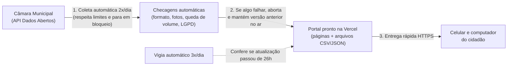

# Guia Completo do Portal — Acompanhe seu Vereador (Pindamonhangaba)

> **Para quem é este guia:** Diretoria e voluntários do **Observatório Social do Brasil – Pindamonhangaba**, jornalistas, advogados/DPO e mantenedores futuros (humanos ou assistentes de IA).
> **Endereço oficial no ar:** `https://acompanhe-seu-vereador.vercel.app` · **Versão:** `1.0.0` · **Atualizado em:** 18 de novembro de 2026.

---

## Sumário

1. [O que é o portal — e o que ele faz questão de NÃO ser](#1-o-que-é-o-portal--e-o-que-ele-faz-questão-de-não-ser)
2. [Passeio pelas telas: o que existe para o cidadão](#2-passeio-pelas-telas-o-que-existe-para-o-cidadão)
3. [Como o portal foi feito (explicado sem economês de TI)](#3-como-o-portal-foi-feito-explicado-sem-economês-de-ti)
4. [Metodologia em profundidade: como cada número nasce](#4-metodologia-em-profundidade-como-cada-número-nasce)
5. [Como o portal se atualiza e como operar no dia a dia](#5-como-o-portal-se-atualiza-e-como-operar-no-dia-a-dia)
6. [O que o Observatório TEM que fazer e o que PODE fazer (Jurídico, Domínio, Custos e Hospedagem para ONG)](#6-o-que-o-observatório-tem-que-fazer-e-o-que-pode-fazer)
7. [Passagem de bastão: para a Diretoria e para quem assumir amanhã](#7-passagem-de-bastão-para-a-diretoria-e-para-quem-assumir-amanhã)

---

## 1. O que é o portal — e o que ele faz questão de NÃO ser

O **Acompanhe seu Vereador** é o painel cívico aberto e gratuito do **Observatório Social do Brasil – Pindamonhangaba** (CNPJ `30.197.903/0001-75`) criado para substituir o antigo relatório manual em Power BI. Em vez de exigir que um voluntário baixe e conte planilhas à mão uma vez por mês, o próprio portal recolhe os registros publicados pela Câmara Municipal duas vezes ao dia e os organiza para qualquer morador consultar pelo celular em poucos segundos.

Na coleta de produção de `18/11/2026`, o portal reunia **17.545 proposições**, **409 leis e normas** e os **11 vereadores em exercício** da legislatura **2025–2028** (desde 1º de janeiro de 2025).

### Os 6 compromissos inegociáveis do projeto

1. **Todo número tem dono e abre a lista real ("número = lista"):** nenhum número aparece solto ou arredondado "no chute". Tocou em *180 projetos* ou em *45 pedidos para o Araretama*? O clique abre exatamente a lista daqueles 180 ou 45 documentos, e todo item abre o documento oficial no site da Câmara.
2. **Apartidarismo absoluto:** todos os vereadores aparecem em **ordem alfabética**, com as fotos oficiais em **preto e branco**, sem cor de partido, sem medalha, sem "vereador mais produtivo", sem nota e sem ranking.
3. **Quantidade não é qualidade:** quem apresenta 500 indicações de tapa-buraco não é "melhor" nem "pior" que quem trabalhou meses em 3 projetos de lei complexos — e o presidente da Câmara tem papel regimental diferente dos demais. O portal explica isso em todas as páginas de comparação e síntese.
4. **Fato oficial separado de interpretação automática:** título, número, data, autoria e resumo oficial (ementa) vêm direto da Câmara. Já "assunto do pedido", "bairro citado", "destinatário" e "projeto que virou lei" são calculados pelo texto e sempre trazem o aviso visual de *classificação automática*.
5. **Lacuna é mostrada como lacuna:** o portal não inventa informação que a Câmara não publica em dados abertos.
6. **Proteção à privacidade (LGPD):** dados sensíveis ou identificáveis de cidadãos comuns em pedidos individuais (como pacientes de saúde) podem ser ocultados sem apagar o ato público nem alterar as contagens.

### O que o portal NÃO é (e limitações da versão 1.0.0)

- **Não é o site oficial da Câmara** (o endereço oficial é `pindamonhangaba.sp.leg.br`, que a Câmara mantém de forma independente).
- **Não mostra como cada vereador votou nem presença em plenário:** a API de Dados Abertos da Câmara Municipal de Pindamonhangaba não publica votações nominais nem lista de presença (presença hoje fica apenas em atas em PDF).
- **Não mostra o andamento (tramitação) atual de um projeto:** para saber se um projeto está em comissão, pautado ou arquivado, o morador clica no título do documento para abrir a ficha completa na Câmara.
- **Traz apenas vereadores em exercício hoje:** a API lista os 11 parlamentares ativos no momento da coleta, sem histórico de suplentes que deixaram o cargo.

---

## 2. Passeio pelas telas: o que existe para o cidadão

O portal foi desenhado para celular e computador sem excesso de menus. Tem **17 páginas** para o usuário e **8 arquivos/rotas técnicos** (mapa do site, busca ao vivo, instalação no celular, monitoramento).

| Endereço | Para que serve na prática |
|---|---|
| `/` *(Capa)* | Mostra quantas proposições existem desde 2025, busca instantânea com atalhos de assuntos, grade alfabética dos 11 vereadores, bairros mais citados e gráficos clicáveis ("Pedidos × Projetos", "Mês a mês", "Assuntos", "A quem se pede", "Do projeto à lei" e "Quem assina junto"). |
| `/vereadores` | Lista os vereadores em exercício com resumo quantitativo, assunto mais frequente e um mini gráfico do ritmo mês a mês de cada mandato. |
| `/vereadores/[nome]` | Perfil individual completo: resumo em 3 fatos clicáveis, painel interativo **Ano a ano** (alterna entre 2025, 2026 e Tudo), perfil de assuntos comparado à média da Câmara (traço de referência), bairros mais citados pelo parlamentar, parceiros de coautoria, leis ligadas a projetos dele e proposições mais recentes. |
| `/comparar` | Compara até **3 vereadores lado a lado na mesma escala** de gráfico (com botão *"Limpar seleção"* e links compartilháveis por WhatsApp). |
| `/bairros` e `/bairros/[bairro]` | Lista e detalha bairros encontrados nos textos das proposições (ex.: Distrito de Moreira César, Araretama, Cidade Nova), com ordenação alfabética ou por citações, filtro instantâneo e página própria de cada bairro. |
| `/proposicoes` | Busca e lista paginada completa com filtros combináveis: tipo, ano do número, vereador, assunto, bairro, destinatário, coautoria, mês de publicação e origem em lei. |
| `/normas` | Leis ordinárias, leis complementares, resoluções e decretos legislativos publicados na legislatura. |
| `/como-funciona` | Explica em linguagem simples o que é Requerimento, Indicação, Moção, Emenda, Projeto de Lei, Veto, Decreto Legislativo e Resolução, além do que fica fora da v1. |
| `/metodologia` | Publica de forma transparente todas as regras automáticas de contagem, temas, bairros e limites do sistema. |
| `/dados` | Permite baixar o acervo inteiro em **CSV** (abre direto no Excel em português) e **JSON**, acompanhado do dicionário oficial dos campos. |
| `/correcoes` | Explica como qualquer pessoa ou gabinete aponta um erro (GitHub público ou e-mail privado quando envolver dados pessoais), com compromisso de resposta em até **15 dias**. |
| `/sobre`, `/privacidade`, `/termos` | Identidade institucional do Observatório, política LGPD completa e condições de uso e neutralidade eleitoral. |
| `/offline` e `/404` | Tela limpa quando o usuário está sem internet (evitando exibir dado desatualizado) e página de erro com atalhos úteis quando um link não existe. |

### Como instalar como aplicativo no celular (PWA)

O portal pode ficar na tela inicial do celular como se fosse um aplicativo, **sem depender de loja da Apple ou Google** e ocupando quase zero espaço:
- **No Android (Chrome / Edge):** abra `https://acompanhe-seu-vereador.vercel.app`, toque nos **três pontinhos (⋮)** no canto superior direito e escolha **"Instalar aplicativo"** ou **"Adicionar à tela inicial"**.
- **No iPhone (Safari):** abra o endereço no Safari, toque no botão **Compartilhar** (quadrado com seta para cima) e escolha **"Adicionar à Tela de Início"**.
- **Cuidado intencional quando falta internet:** ao contrário de apps de notícia comuns, este portal **nunca salva números antigos no celular** para fingir que está atualizado. Sem internet, ele mostra apenas um aviso honesto (*"Sem conexão"*), porque número desatualizado em política pública induz a erro.

---

## 3. Como o portal foi feito (explicado sem economês de TI)

O projeto nasceu para ter **custo zero de manutenção**, **zero risco de invasão por senha vazada** e **zero banco de dados para administrar**. Ele funciona como uma edição de jornal impressa automaticamente duas vezes por dia:



Em termos práticos:
- **Sem banco de dados e sem painel de login:** não existe usuário administrador nem área escondida onde alguém possa invadir para adulterar números. Todo o conteúdo público é gerado diretamente dos arquivos oficiais durante a publicação.
- **Se a Câmara sair do ar, o portal NÃO quebra:** duas vezes por dia a automação pede à Vercel uma nova montagem do site. Antes de colocar a nova edição no ar, o sistema passa por uma bateria rígida de conferência. Se a Câmara estiver indisponível ou devolver dado corrompido, a atualização nova é descartada com segurança e quem acessa o site continua vendo a última edição íntegra, enquanto um alerta é aberto automaticamente no GitHub para avisar o responsável.
- **Privacidade absoluta do visitante:** não há formulários salvando histórico no servidor, não há Google Analytics, não há cookies e nem sequer fontes baixadas do Google — o site usa a letra nativa já instalada no iPhone, Android ou Windows de quem lê, tornando a abertura quase instantânea mesmo em 3G/4G fraco.

---

## 4. Metodologia em profundidade: como cada número nasce

> Esta seção entra em detalhe completo e didático para que qualquer auditor, jornalista, vereador ou voluntário entenda exatamente como o código processa cada documento público da Câmara.

### 4.1 As três camadas da informação

Todo dado exibido no portal pertence a uma de três camadas, nunca misturadas:

1. **Fato oficial da fonte (`Proposicoes`, `Normas`, `Vereadores`):** vem diretamente do sistema SoftCam (`/jsonweb/web-aplicativo.php`), consultado com token oficial de cidadão. O portal aplica apenas duas limpezas de leitura para o ser humano, **sem alterar nenhuma palavra**:
   - Decodifica entidades HTML residuais publicadas pela fonte (`&quot;`, `&apos;`, `&amp;`, `&lt;`, `&gt;`, `&nbsp;` viram aspas, apóstrofo etc.).
   - Quando uma ementa foi digitada quase inteira em CAIXA ALTA (mais de 80% de maiúsculas em textos com 12+ letras), converte para minúsculas com maiúscula inicial de frase, facilitando a leitura sem perder o texto original no link da Câmara.
2. **Contagem exata (invariante *"número = lista"*):** o número exibido num cartão, barra, coluna mensal ou tabela usa exatamente a mesma função de filtro (`filtrar` + `buscar` + `contar`) da página `/proposicoes` ou `/normas` para a qual ele aponta. Testes automatizados verificam continuamente essa igualdade.
3. **Classificação automática derivada (assunto, bairro, destinatário, vínculo projeto-lei):** como a Câmara não entrega esses campos separados na API, regras públicas e determinísticas leem a ementa para organizar os dados. Sempre que essa camada aparece na tela, vem acompanhada do selo informativo *"Classificação automática..."*.

### 4.2 Escopo temporal e a diferença entre "Ano do número" e "Mês de publicação"

- **Recorte:** legislatura **2025–2028** (a partir de `2025-01-01`). Entra no acervo todo documento cuja data de publicação seja `>= 2025-01-01` **ou** cujo número oficial traga ano `>= 2025`.
- **Ano do filtro vs. Mês do gráfico:**
  - Quando você filtra por **Ano** (ex.: `Ano: 2026`), o portal lê o **ano do número oficial** do documento (*Requerimento nº 2398/2026*).
  - Já os gráficos **Mês a mês** usam a **data em que a Câmara publicou** o documento no sistema (`data`), que em sessões de virada de ano pode cair em janeiro de um ato numerado no fim de dezembro, ou vice-versa. Ambos estão corretos em suas respectivas definições.

### 4.3 Coautoria, nomes antigos e autores fora da Câmara

- **Coautoria conta para cada autor ativo:** se um requerimento traz *"Marco Mayor; Ana Paula Goffi; Professor Everton"*, esse mesmo documento aparece na página dos três parlamentares. Portanto, a soma individual dos perfis será maior que o total único de proposições da Câmara — isso é esperado e documentado. Na capa, o portal informa quantos porcento das proposições têm autor único e quantos pares já assinaram juntos.
- **Mudança de nome parlamentar:** comparar apenas pelo nome de tela faria desaparecer proposições antigas caso um vereador mudasse a grafia oficial durante o mandato. Por isso existe um dicionário versionado de apelidos históricos (`src/lib/content/apelidos.ts`):
  - **Norberto Moraes (`norberto-moraes`):** também casa registros antigos assinados como `"Norbertinho"`.
  - **Felipinho César (`felipinho-cesar`):** também casa registros assinados como `"Felipe César Filho - FC"`, `"Felipe César Filho"` e `"Felipe Cesar - FC"`.
- **Executivo, Mesa e ex-suplentes:** proposições do Poder Executivo, de Comissões ou de parlamentares não em exercício permanecem pesquisáveis nas listas gerais (`/proposicoes`), mas não ganham página de perfil parlamentar nesta versão.

### 4.4 Os 4 grupos dos gráficos e os 19 tipos catalogados

Para os gráficos comparativos (como a barra de proporção na capa e nos perfis), o portal agrupa os tipos oficiais da Câmara em **4 blocos com função cívica distinta**:

| Grupo | Cor no gráfico | Tipos oficiais da Câmara incluídos |
|---|---|---|
| **Pedidos** | Cinza escuro | Indicações (`Indicacoes`), Requerimentos (`Requerimentos`) e Indicações de Projetos de Lei (`Indicacoes-de-Projetos-de-Lei`). |
| **Projetos de lei** | Verde OSB | Projetos de Lei Ordinária, Projetos de Lei Complementar, Projetos de Lei de Iniciativa Popular, Propostas de Emenda à Lei Orgânica, Emendas e Vetos. |
| **Homenagens** | Cinza médio | Moções (`Mocoes`) e Projetos de Decreto Legislativo (`Projetos-de-Decreto-Legislativo` — ex.: títulos honoríficos). |
| **Funcionamento da Câmara** | Cinza claro | Projetos de Resolução, Relatórios Finais de Comissão e Representações ao Conselho de Ética (e demais registros internos que não se enquadrem acima). |

Na seção **Leis e normas (`/normas`)**, são coletadas as **5 famílias normativas** publicadas: Leis Ordinárias, Leis Complementares, Emendas à Lei Orgânica, Resoluções e Decretos Legislativos. Atos meramente administrativos internos ficam apenas no site oficial da Câmara.

### 4.5 Classificação automática de Assuntos (12 temas — `src/lib/data/temas.ts`)

Aplica-se aos **Pedidos** (`grupo = pedidos`). Antes de comparar palavras, o texto da ementa passa por normalização (remove acentos, converte para minúsculas e unifica espaços). **Um mesmo pedido pode entrar em mais de um tema** (por exemplo, *"lâmpada de LED na rua do bairro"* entra em **Iluminação** e **Ruas e asfalto**) ou em **nenhum**.

Cada expressão foi ajustada manualmente contra dados reais da Câmara para cortar falsos positivos comuns:

| # | Assunto | O que o algoritmo procura (normalizado, sem acentos) | Falsos positivos bloqueados de propósito |
|---:|---|---|---|
| 1 | **Ruas e asfalto** | `afundament*`, `asfalt*`, `pavimenta*`, `recape*`, `tapa-buraco*`, `buraco*`, `cascalh*`, `patrolament*`, `calcament*`, `calcada*`, `guia e sarjeta*`, `sarjet*`, `estrada*`, `meio-fio`, `operacao tapa`, `nivelament*`, `terraplenage*`. | — |
| 2 | **Iluminação** | `ilumina*`, `lampada*`, `poste(s/amento)`, `luminaria*`, `reator*`, `led`. | Exige palavra inteira em `poste`: não casa *"posteriormente"* nem *"proposta"*. |
| 3 | **Limpeza e meio ambiente** | `meio ambiente`, `ambienta*`, `ecologic*`, `lixeira*`, `reciclage*`, `rocad*`, `roca*`, `poda*`, `capina*`, `mato`, `matagal*`, `limpeza*`, `entulho*`, `lixo*`, `coleta de lixo`, `varricao`, `corte/supressao de arvore*`, `arvore*`. | `mato` isolado não casa sobrenomes como *"Matos"*; `roca*` não casa *"rocha"*. |
| 4 | **Água, esgoto e drenagem** | `sabesp`, `esgoto*`, `vazament*`, `agua(s)`, `pluvia*`, `drenage*`, `bueiro*`, `galeria*`, `boca(s) de lobo`, `alagament*`, `enchente*`, `enxurrada*`, `saneamento`, `corrego*`, `canalizacao`. | Palavra inteira em `agua(s)`: *"aguardar"* e *"desaguamento"* não entram por engano. |
| 5 | **Trânsito e transporte** | `faixa elevada`, `transito`, `sinaliza*`, `lombada*`, `redutor(es) de velocidade`, `semaforo*`, `faixa de pedest*`, `onibus`, `transporte*`, `ponto de onibus`, `abrigo*`, `estacionament*`, `mobilidade`, `ciclovia*`, `viva pinda`, `placa*`. | — |
| 6 | **Saúde** | `saude`, `ubs`, `hospita*`, `medic*(exceto medicao/medicoes)`, `remedio*`, `vacina*`, `posto de saude`, `pronto-socorro`, `upa`, `samu`, `consulta(s)(exceto consulta publica)`, `exame*`, `dengue`, `enfermag*`. | Lookahead negativo bloqueia **"medição"** em `medic*` e **"consulta pública"** em `consulta*`. |
| 7 | **Educação** | `escola*`, `creche*`, `educa*`, `ensino`, `aluno*`, `professor/professora(s)` (exceto `professor everton` e `professor felipe`), `merenda`, `cmei`, `emef`, `emeief`, `ee `. | Evita atribuir ao tema *Educação* toda proposição apenas por mencionar *"Professor Everton"* ou *"Professor Felipe Guimarães"*. |
| 8 | **Esporte, lazer e cultura** | `parque infantil`, `centro comunitari*`, `centro de convivencia`, `praca*`, `quadra(s)`, `campo de futebol`, `esport*`, `lazer`, `parquinho*`, `playground`, `academia ao ar livre`, `cultur*`, `evento*`, `festa*`, `biblioteca*`, `teatro`. | — |
| 9 | **Assistência social** | `idos*`, `deficien*`, `pcd`, `autis*`, `tea`, `cras`, `creas`, `assistencia social`, `vulnerab*`, `morador(es) de rua`, `situacao de rua`, `cesta(s) basica(s)`, `acessibilidade`. | `tea` exige fim de palavra (não casa *"teatro"*). |
| 10 | **Segurança** | `seguranca`, `guarda municipal`, `policia*`, `ronda*`, `camera*`, `monitorament*`, `videomonitorament*`, `vandalismo`, `furto*`, `roubo*`. | — |
| 11 | **Animais** | `anima*`, `cao`, `caes`, `cachorro*`, `gato*`, `castracao*`, `zoonose*`, `pet(s)` (exceto `garrafa(s) pet`), `cavalo*`, `equino*`, `veterinari*`. | Lookbehind negativo garante que reciclagem de **"garrafa PET"** não entre como causa animal. |
| 12 | **Homenagens** | `aplauso*`, `congratula*`, `homenage*`, `titulo de cidada*`, `cidadao pindamonhangabense`, `medalha*`, `comenda*`, `denomina*`, `da nome`, `dia municipal`, `semana municipal`, `pesar`, `voto(s) de`. | — |

### 4.6 Extração automática de Bairros (`src/lib/data/extrair.ts` + `src/lib/content/bairros.ts`)

A API da Câmara tem um campo de bairros, mas ele vem vazio. O portal extrai os nomes diretamente da frase da ementa:

1. **Gatilhos procurados:** expressões contendo `bairro`, `bairros` ou `distrito de`.
2. **Onde a leitura do nome para:** o leitor lê no máximo 6 palavras e interrompe ao encontrar pontuação final (`. ; : ! ? / – —`), palavra de transição (`rua`, `avenida`, `av`, `estrada`, `localizado`, `proximo`, `visando`, `solicitando`, `conforme`, etc.), ou continua em listas múltiplas quando o gatilho é plural (*"nos bairros Feital, Vista Alegre e Terra Nova"*) ou quando dois núcleos começam em maiúscula (*"Morumbi I e Morumbi II"*). Mantém preposições no meio de nomes compostos (*"Parque das Nações"*) e aceita numerais romanos e prefixos populares (*Vila, Jardim, Parque, Cidade, Residencial, Terra, Portal, Chácara*).
3. **Unificação controlada de grafias (`VARIANTES_BAIRRO`):** 15 grupos de grafias idênticas já comprovadas são mesclados no mesmo bairro (acentos e maiúsculas já são ignorados pelo identificador interno):
   - **Shangrilá** (`Shangri-lá`, `Shangri-la`, `Shangrila`, `Shangri Lá`, `Shangri`)
   - **Bom Sucesso** (`Bonsucesso`)
   - **Jardim Eloyna** (`Jardim Eloina`, `Jardim Eloína`, `Jardim Heloyna`)
   - **Massaim** (`Massain`, `Maçaim`)
   - **Jardim Rezende** (`Jardim Resende`)
   - **Laerte Assumpção** (`Laerte Assunção`)
   - **Alto do Cardoso** (`Alto Cardoso`)
   - **Alto Tabaú** (`Alto do Tabaú`)
   - **Vitória Park** (`Vitória Parque`)
   - **Chácara da Galega** (`Chácara Galega`, `Chácaras Galega`, `Galega`)
   - **Ipê I** (`Ipê 1`) e **Ipê II** (`Ipê 2`)
   - **Terra dos Ipês II** (`Terra dos Ipê II`)
   - **Marieta Azeredo** (`Marieta Aparecida Azeredo`)
   - **Distrito de Moreira César** (`Moreira César`, `Distrito de Moreira`)
4. **Palavras genéricas bloqueadas (`NAO_E_BAIRRO`):** descarta termos que às vezes vêm logo depois de "bairro" sem nomear um lugar (*Residencial, Loteamento, Jardim, Vila, Parque, Santa, São, Conjunto, Bairro, Pindamonhangaba, Município, Cidade, Outras, Outros, Região, Zona*) além de nomes que comecem com `zona` ou `regiao` (como `"zona leste"`).
5. **Regra de corte mínima (evita poluição por erro isolado):**
   - Na lista geral de **`/bairros`** e na capa, só entram bairros citados **pelo menos 3 vezes** (`MIN_BAIRRO = 3`) na Câmara inteira.
   - No **perfil de cada vereador** e em `/comparar`, exibem-se os bairros citados **pelo menos 2 vezes** por aquele vereador (`min = 2` em `raioX`).
   - Pedidos que trazem apenas o nome da rua sem mencionar o bairro não entram nessa conta.
   - **Pendente de confirmação local:** grafias próximas que podem ser lugares distintos (`Andrade` vs `Residencial Andrade`, `Ipê` vs `Ipê I`) são mantidas propositalmente separadas até alguém do município confirmar se são o mesmo lugar.

### 4.7 "A quem se pede", "Do projeto à lei" e Rede de Coautoria

- **A quem se pede (`destinoDe`):** examina apenas os **primeiros 160 caracteres** da ementa (onde fica o vocativo *"Ao Executivo Municipal..."*, *"À Sabesp..."*), seguindo esta ordem:
  1. Concessionárias/órgãos específicos: **EDP** (`edp`, `bandeirante energia`, `energia eletrica`), **Sabesp** (`sabesp`, `companhia de saneamento`), **DER** (`der`, `departamento de estradas de rodagem`), **Viva Pinda (ônibus)** (`viva pinda`), **Mesa Diretora da Câmara** (`mesa diretora`), **Governo do Estado ou federal** (`governador`, `deputado`, `ministro`, `presidente`, `senador`, `secretaria estadual`, `estado de sao paulo`).
  2. **Prefeitura:** quando cita `executivo`, `prefeito`, `secretaria`, `departamento`, `administracao municipal`, começa com `indico`, ou pertence a qualquer tipo de **Indicação** (que por regra regimental sempre é encaminhada ao Executivo).
  3. **Outros:** tudo que não corresponder aos itens acima.
- **Do projeto à lei (`projetoDeOrigem`):** a API não traz um campo "lei X veio do projeto Y". O portal procura dentro da ementa das normas o padrão textual `Projeto de (Lei | Lei Complementar | Decreto Legislativo | Resolução | Emenda à Lei Orgânica) nº <número>/<ano>` e vincula exatamente ao projeto com aquele tipo, número e ano.
  - **Limitação crucial:** leis de iniciativa do **Poder Executivo** frequentemente não mencionam o número do projeto em sua ementa oficial, e projetos ainda em tramitação somam no denominador — logo, a razão apresentada é sempre um **piso mínimo observável**, e o portal declara essa restrição explicitamente.
- **Rede de coautoria (`pares`):** calcula todos os pares distintos entre os 11 vereadores em exercício (`C(11,2) = 55` pares possíveis) que assinam juntos uma mesma proposição; a espessura da linha na tela cresce proporcionalmente à quantidade em comum.

### 4.8 Busca inteligente e exportação CSV segura

- **Busca inteligente (`src/lib/data/busca.ts`):** ao digitar `req 2398/2026`, `pl 45`, `iluminação Araretama` ou `Norbertinho`, o motor separa abreviações de tipo (`req`, `ind`, `pl`, `plc`, `pr`, `pdl`, `mocao`, `emenda`, `veto`), extrai número/ano com ou sem `nº`, ignora acentos e busca palavras inteiras/parciais simultaneamente em ementa, título, autoria, nomes parlamentares, apelidos históricos e bairro. O limite máximo por consulta é de **120 caracteres**, sem armazenamento em cache compartilhado (`Cache-Control: private, no-store`).
- **CSV seguro (`src/lib/data/csv.ts`):** os arquivos abertos `.csv` usam ponto e vírgula (`;`) e marca BOM UTF-8 (para abrir com acentos perfeitos no Microsoft Excel em português). Células cujo texto comece com `=`, `+`, `-` ou `@` recebem automaticamente um apóstrofo (`'`) antes, neutralizando ataques de injeção de fórmula em planilhas.

### 4.9 As travas de segurança do coletor e as Omissões LGPD

O coletor (`src/lib/coleta/coletar.ts` + `src/lib/camara/client.ts`) obedece a regras rígidas de respeito institucional à Câmara:
1. **Identificação transparente (`User-Agent`):** declara projeto, contato `pindamonhangaba@osbrasil.org.br` e repositório GitHub.
2. **Pausa mínima:** mínimo de **1.100 ms** (>= 1 s) entre requisições sequenciais; se a Câmara devolver código `429`, respeita o cabeçalho `Retry-After` (limitado a 60 s) e faz no máximo 3 tentativas com recuo exponencial em falhas `5xx`.
3. **Respeito ao anti-robô (`Bot Verification`):** nunca tenta burlar CAPTCHA. Se qualquer resposta HTML contiver `Bot Verification` ou `lsrecap`, aborta imediatamente.
4. **Contrato estrito com Zod (`schema.ts`):** HTTP 200 vazio (forma como a API responde sem token) dispara erro imediato; campos desconhecidos novos são registrados em `avisos` no manifesto para inspeção humana.
5. **Janela incremental e re-coleta limpa:** coletas diárias buscam apenas as páginas novas com sobreposição de **45 dias** (`SOBREPOSICAO_DIAS = 45`) para captar alterações recentes; a cada **30 dias** (`FULL_REFRESH_DIAS = 30`), faz coleta completa do zero para refletir atos excluídos ou retificados na fonte.
6. **Bloqueio de queda brusca e escrita atômica:** se o total novo cair mais de **10%** (`QUEDA_MAXIMA = 0.1`) em relação ao cache ou ao manifesto já publicado, o coletor considera que a API falhou e aborta o build antes de sobrescrever o site publicado; fotos baixadas passam por validação de origem (`https://` em `pindamonhangaba.sp.leg.br`), cabeçalho binário PNG/JPEG/GIF/WebP e teto de 5 MB.
7. **Omissões LGPD (`src/lib/content/omissoes.ts`):** mantém lista de chaves `<tipo>:<id>` cujo resumo oficial é substituído por uma nota padrão neutra na tela e nos arquivos abertos CSV/JSON, **sem apagar o registro nem mencionar o nome do cidadão no código público**, mantendo o link direto para o documento na Câmara. Em `18/11/2026`, estão ocultadas preventivamente as ementas dos Requerimentos **`130774`**, **`132682`** e **`134695`** por conterem dados sensíveis de saúde de cidadãos identificáveis. A sentinela `npm run auditar:heuristicas` rastreia CPFs, e-mails, telefones e termos de prontuário/paciente nas coletas publicadas.

---

## 5. Como o portal se atualiza e como operar no dia a dia

### 5.1 Automação (sem nenhuma intervenção humana)

| Rotina | Quando roda | O que faz exatamente |
|---|---|---|
| `atualizar-dados.yml` | A cada hora (minuto 17 UTC) | Confere a idade da última coleta publicada. Só dispara nova coleta se tiver **mais de 11 h** e nenhuma tentativa tiver ocorrido nas **últimas 3 h**. Na prática atualiza a cada **~12 h** (2x/dia) usando cerca de 60 consultas à API em ~2 minutos. |
| `vigia-dados.yml` | 3x ao dia (`06h43`, `14h43`, `22h43` BRT) | Lê `/dados/manifesto.json` e `/api/health` na Vercel. Abre issue automática (`dados-desatualizados`, enviando e-mail ao dono) se passar de **26 h** sem atualizar, se houver avisos ou se `/api/health` divergir; fecha automaticamente quando volta ao normal. |
| `quality-gates.yml` | A cada alteração de código | Roda auditoria de vulnerabilidades (`npm audit`), caça a vazamento de segredos, lint estático AST, checagem de tipos TypeScript, 144 testes unitários, build completo e bateria E2E/acessibilidade com Playwright. |

### 5.2 Operação sem saber programar (em cliques)

- **Forçar atualização agora:** abra a **Vercel** → projeto **`acompanhe-seu-vereador`** → **Deployments** → no deploy `Production` mais recente clique em **`⋯`** → **Redeploy** (deixe marcado **"Use existing Build Cache"** para rodar em ~2 min).
- **Voltar para a versão de ontem (Rollback em 1 minuto):** Vercel → **`acompanhe-seu-vereador`** → **Deployments** → escolha um deployment antigo íntegro → **`⋯`** → **Promote to Production**.
- **Conferir rapidamente se está no ar e qual código roda:** acesse no navegador `https://acompanhe-seu-vereador.vercel.app/api/health` (deve mostrar `"ok": true`, a versão `1.0.0`, o código do commit e a data/total de proposições).
- **Melhoria operacional recomendada (`VERCEL_DEPLOY_HOOK_URL`):** hoje, quando não há esse segredo, o robô `atualizar-dados` cria 2 micro-commits diários no histórico do Git só para avisar a Vercel de reconstruir. Criar um Deploy Hook na Vercel (*Settings → Git → Deploy Hooks*) e salvá-lo em *GitHub → Settings → Secrets and variables → Actions* com o nome `VERCEL_DEPLOY_HOOK_URL` deixa o histórico de código totalmente limpo (lembre apenas de fazer algum pequeno envio ao repositório ou reativar os crons se ficar mais de 60 dias sem nenhum commit no GitHub, pois o GitHub pausa automações após 60 dias sem pushes).

### 5.3 Como atender um pedido LGPD ou aviso de erro em até 15 dias

1. **Nunca discuta dados pessoais em issue pública do GitHub** (toda issue é pública e indexável pelo Google). Pedidos de sigilo/omissão devem chegar pelo e-mail institucional **`pindamonhangaba@osbrasil.org.br`**.
2. **Conferência:** confirme que o pedido veio do próprio titular ou representante legal, localize o link oficial na Câmara (`<tipo>` e `<id>` numérico no final da URL, ex.: `/proposicoes/.../154351` → chave `Requerimentos:154351`).
3. **Aplicação técnica:** basta adicionar uma linha em [`src/lib/content/omissoes.ts`](../src/lib/content/omissoes.ts) — ex.: `{ chave: "Requerimentos:154351", desde: "2026-11-20", referencia: "email-2026-11-20" }` — **nunca escrevendo o nome da pessoa no arquivo**. Ao publicar, a ementa some do portal e dos arquivos abertos CSV/JSON, respondendo ao cidadão dentro do prazo de **15 dias**.
4. **Orientação importante ao cidadão:** explique educadamente que o Observatório apenas ocultou o resumo *neste portal*; para retirar o texto do documento original, ele precisa protocolar solicitação também diretamente à **Câmara Municipal de Pindamonhangaba**.

---

## 6. O que o Observatório TEM que fazer e o que PODE fazer

### 6.1 Revisão jurídica real e profunda (para advogado/DPO humanizado)

> **Nota importante:** Esta lista não substitui parecer jurídico formal de advogado ou Encarregado de Dados (DPO). Ela traduz os pontos técnicos concretos do portal para que a diretoria leve exatamente as perguntas certas ao jurídico do OSB.

| Área legal | O que já está protegido no sistema hoje | O que o jurídico / Diretoria TEM que revisar e aprovar |
|---|---|---|
| **LGPD — Controlador e Canal (arts. 5º VI, 18 e 41)** | `/privacidade` identifica o **Observatório Social do Brasil – Pindamonhangaba/SP** (`30.197.903/0001-75`), endereço na Rua Deputado Claro César, 44, sobreloja, e-mail `pindamonhangaba@osbrasil.org.br` e prazo de resposta de **15 dias** também em `/correcoes`. | Confirmar oficialmente por ata/termo interno quem responde como responsável/Encarregado (art. 41) pela caixa `pindamonhangaba@osbrasil.org.br`, garantindo leitura regular para não perder o prazo de 15 dias previsto em lei (art. 19 § 2º). |
| **LGPD — Dados Sensíveis de Saúde e Menores (arts. 5º II, 11 e 14)** | Os 3 requerimentos detectados na coleta real (`130774`, `132682`, `134695`) foram omitidos em `omissoes.ts`; `/privacidade` explicita omissão preventiva para saúde/vulnerabilidade e menores de idade; sentinela periódica configurada. | Validar juridicamente a redação da nota padrão de substituição (`TEXTO_OMITIDO`) e decidir a frequência com que um voluntário rodará a varredura preventiva (`npm run auditar:heuristicas`), já que novas proposições com nomes de pacientes podem surgir na Câmara entre revisões. |
| **LGPD — Decisões Automatizadas (art. 20) e Bases Legais (art. 7º §§ 3º, 4º, 7º e IX)** | `/privacidade` declara expressamente que classificações automáticas incidem apenas sobre o texto público dos atos parlamentares, não avaliam pessoas naturais nem formam perfilamento de cidadão, apoiando-se na publicidade de atos oficiais (LAI 12.527/2011) e controle social. | Revisar o texto integral de `/privacidade` (e conferir alinhamento com a política nacional da rede OSB linkada no portal). |
| **LGPD — Transferência Internacional e Cookies (art. 33)** | Zero cookies, zero analytics, zero banco de usuários; `/privacidade` declara explicitamente que logs de acesso padrão ficam na operadora Vercel Inc. (com possível trânsito fora do Brasil). | Caso o OSB venha a contratar advogado especialista em LGPD, validar a cláusula de transferência internacional (art. 33) para hospedagem na Vercel ou decidir hospedar em servidor físico no Brasil. |
| **Direito Eleitoral (Lei nº 9.504/1997)** | Ordem exclusivamente alfabética, zero ranking/nota/cor de partido; `/termos` §6 cita expressamente a Lei nº 9.504/1997 e proíbe patrocínio, anúncios, impulsionamento pago e uso eleitoral da marca do OSB. | Orientar diretoria e voluntários para **nunca impulsionarem postagens patrocinadas** ligando para recortes individuais em período eleitoral e responder formalmente em caso de candidato usando recortes fora de contexto. |
| **Direito de Imagem — Retratos Oficiais (`/termos` §5)** | Retratos oficiais vêm da API pública de dados abertos da Câmara, tratados igualmente em preto e branco; `/termos` §5 prevê atualização ou troca por monograma mediante pedido de gabinete. | Confirmar com o jurídico se a reprodução em cache local dessas fotos institucionais dispensa ofício à Câmara ou se convém enviar uma comunicação cortês institucional dando ciência do portal e do canal para atualização de foto. |
| **Autorização Formal de Marca, CNPJ e Termos** | Código aberto sob licença MIT (`LICENSE`), com ressalva expressa de que a licença de código não se estende ao logotipo nem ao nome OSB. | Formalizar em ata da Diretoria do OSB Pindamonhangaba que o projeto está autorizado a exibir o logotipo, nome completo, CNPJ e endereço da unidade local em produção. |

### 6.2 Domínio definitivo (quanto custa e qual escolher)

Hoje o portal usa o endereço único **`https://acompanhe-seu-vereador.vercel.app`** (gratuito, consolidado, com os endereços duplicados antigos já removidos). O Observatório tem três caminhos possíveis:

| Caminho | Quanto custa | Pontos fortes | Pontos de atenção |
|---|---|---|---|
| **1. Manter `acompanhe-seu-vereador.vercel.app`** *(atual em produção)* | **Zero** | Já funciona, tem HTTPS automático, não quebra links nem quem já salvou no celular. | Mostra `.vercel.app` no endereço; fica ligado à conta Vercel do mantenedor. |
| **2. Pedir subdomínio oficial ao OSB Nacional** *(ex.: `vereadores.pindamonhangaba.osbrasil.org.br` ou sob `sistemaosb.com.br`)* | **Zero** | Credibilidade institucional máxima do Observatório sem pagar nada. | Depende de aprovação e ajuste DNS da equipe técnica do OSB Nacional. |
| **3. Registrar domínio próprio `.org.br`** *(ex.: `vereadorespinda.org.br`, `acompanheseuvereador.org.br` — conferir disponibilidade no Registro.br)* | **~40 reais por ano** no Registro.br (no CNPJ do OSB) | Independência total para sempre, nome fácil de lembrar em jornal e rádio, controle próprio no Registro.br mesmo se mudar de hospedagem no futuro. | Exige cartão/boleto da ONG uma vez por ano e cuidar da renovação anual para nunca expirar. |

> **Conselho prático para uma ONG:** no dia a dia, manter `acompanhe-seu-vereador.vercel.app` agora e pedir um `.org.br` (~40 reais/ano no CNPJ do OSB) ou subdomínio do OSB Nacional no médio prazo dá autonomia total sem prender a entidade ao endereço de uma única plataforma.

### 6.3 Hospedagem e custos reais para uma ONG (sem complicação)

Existe **um alerta contratual importante** sobre onde o site mora hoje:

- A **Vercel** oferece um plano gratuito excelente chamado *Hobby*, mas **os termos de uso oficiais restringem o Hobby a uso pessoal não comercial**. Embora permitir doações para projeto sem fins lucrativos não seja considerado comercial, a Vercel exige que nenhum desenvolvedor seja pago e normalmente não enquadra organizações/associações formais no Hobby (o próximo plano oficial da Vercel, *Pro*, custa cerca de **20 dólares por mês**, ou mais de **1.400 reais por ano**, o que não faz sentido para uma ONG local que não fatura).

Veja as alternativas reais, em português simples, do jeito mais barato e seguro para uma associação civil:

| Opção de hospedagem | Custo estimado | Para quem faz sentido e o que exige |
|---|---|---|
| **A. Permanecer na Vercel gratuita (atual) + consulta ao suporte** | **Zero** | Bom para começar imediatamente enquanto o projeto é tocado por voluntários em conta pessoal sem fins lucrativos e código aberto MIT. **Ação recomendada:** enviar uma mensagem simples ao suporte da Vercel pedindo confirmação por escrito ou aplicando ao programa open-source/não comercial, mantendo ciência de que a empresa pode pedir mudança de plano no futuro. |
| **B. VPS simples para ONGs (ex.: Hostinger KVM 1 ou equivalente no Brasil)** — *Alternativa recomendada para independência total* | **~25 a 35 reais por mês** (~300 a 400 reais por ano com `.org.br`, em plano promocional anual) | Pense numa VPS como **"alugar um pequeno computador ligado 24 horas por dia só da ONG"**. **Vantagens enormes:** ninguém derruba ou cobra taxa surpresa por limite de banda ou regra comercial de "Hobby"; o servidor fica fisicamente no Brasil (carrega mais rápido em Pindamonhangaba, ~0,13s); cabe facilmente todo o portal, pois ele consome menos de 256 MB de memória. **O que exige:** um voluntário com noção básica de Linux uma única vez para colocar o projeto rodando dentro de um contêiner simples com HTTPS automático (usando o próprio servidor do projeto já testado no histórico até `18/11/2026`, fácil de reativar quando quiserem) e agendar o cron do GitHub Actions para atualizar a imagem. |
| **C. Hospedagem estática gratuita compatível com ONGs (Cloudflare Pages / GitHub Pages)** | **Zero** | Diferente da Vercel Hobby, o Cloudflare Pages gratuito tem termos bem mais amigáveis para sites comunitários sem fins lucrativos e tráfego ilimitado. **Por que não está pronto assim hoje:** a caixa de busca instantânea (`buscar enquanto digita`) hoje roda no servidor da Vercel (`/api/busca`). Para rodar de graça sem servidor (100% estático), bastaria um voluntário adaptar essa caixinha de busca para filtrar os arquivos JSON diretamente no navegador do usuário em vez de consultar `/api/busca`. |

### 6.4 O que o Observatório PODE fazer na próxima etapa (evoluções v2)

1. **Ofício / Pedido LAI à Câmara Municipal:** solicitar que a Câmara passe a incluir na API `/jsonweb/` **votações nominais**, **lista de presença** e **andamento (tramitação)** — dados que hoje ficam presos em atas PDF ou fora da API. Isso destravaria a fase 2 sem trabalho manual.
2. **Revisar os bairros parecidos em um café com voluntários:** olhar a lista gerada por `npm run auditar:heuristicas` e confirmar se `"Andrade"` = `"Residencial Andrade"` e `"Ipê"` = `"Ipê I"` (e novos apelidos de bairros locais) para unir em `src/lib/content/bairros.ts`.
3. **Teste real em 2 celulares com leitores de tela:** abrir o site num **iPhone (Safari + VoiceOver)** e num **Android (Chrome + TalkBack)** para validar instalação na tela inicial e navegação por voz/gesto (testes automatizados em computador não substituem o toque real no aparelho).

---

## 7. Passagem de bastão: para a Diretoria e para quem assumir amanhã

### Mapa de contas e chaves que a Diretoria deve guardar com segurança

- **GitHub do código:** repositório público `vhonorato02/acompanhe-seu-vereador` (licença MIT).
- **Painel da Vercel:** time `jose-victors-projects-5cc9abbe`, projeto `acompanhe-seu-vereador` — é aqui que mora o segredo **`CAMARA_API_TOKEN`** (única chave confidencial do projeto; nunca deve ser colada no código nem enviada em chats/issues).
- **E-mail oficial do canal LGPD e correções:** `pindamonhangaba@osbrasil.org.br`.

### Guia rápido para a próxima IA ou voluntário de TI que assumir

1. **Leia primeiro [`HANDOFF.md`](../HANDOFF.md)** (estado real publicado, última coleta, pendências e rollback) e [`CLAUDE.md`](../CLAUDE.md) (regras inegociáveis do projeto).
2. **Consulte a auditoria anterior em [`docs/auditoria/2026-11-18-profunda/`](auditoria/2026-11-18-profunda/08-relatorio-final.md):** lá estão todos os 158 arquivos inventariados (`livro-arquivos.csv`), todas as 25 rotas (`livro-telas.csv`), todos os achados (`achados.csv`) e a matriz de testes.
3. **Regra de ouro antes de tocar na `main`:** nunca faça alterações em série direto no ramo `main`, porque todo push na `main` dispara um build real na Vercel contra a API da Câmara. Trabalhe sempre em um ramo separado, valide localmente com:
   ```bash
   npm run auditar:cobertura && npm run lint && npm run typecheck && npm test && npm run build
   ```
   e só depois publique.
4. **Checklist semestral de saúde para o Observatório:**
   - Rodar `npm run auditar:heuristicas` e checar novos bairros e possíveis menções sensíveis de saúde/menores em novas proposições;
   - Verificar se nenhuma issue `dados-desatualizados` ficou aberta no GitHub;
   - Confirmar se nenhum vereador mudou de nome parlamentar ou foto na Câmara;
   - Confirmar que a caixa `pindamonhangaba@osbrasil.org.br` não tem pedidos LGPD próximos do prazo de 15 dias.
